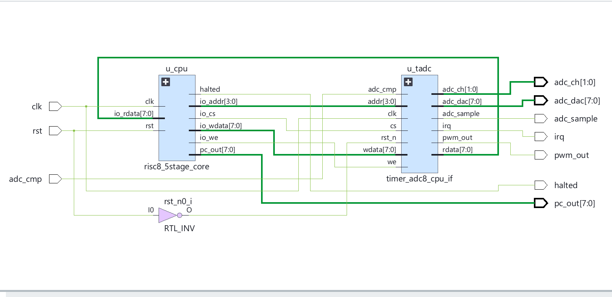
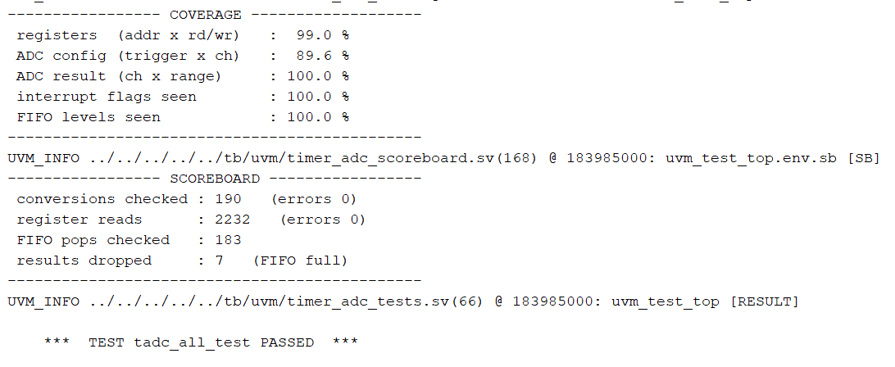
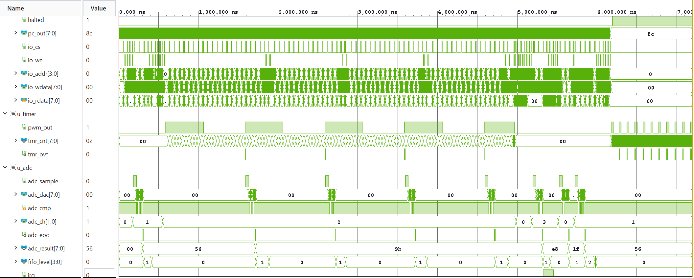
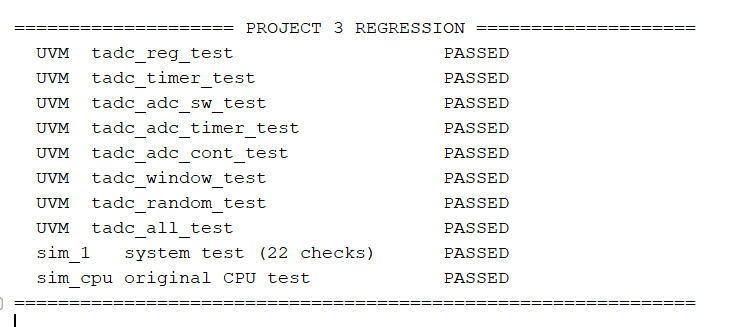

# 8-bit Timer + 8-bit SAR ADC with UVM, integrated into the RISC-8 CPU

An 8-bit **timer** (prescaler, compare, PWM) and an 8-bit **SAR ADC** (4 channels, 8-entry FIFO,
window comparator, interrupts) written in Verilog-2001. The peripheral is verified with a
**UVM 1.2** testbench in SystemVerilog and then connected to my
RISC-8 5-stage pipeline CPU from project 2 as **memory-mapped I/O at 0xF0–0xFF**. Everything is simulated in **AMD Vivado 2026.1** (XSim with the built-in UVM library).

---

## Highlights

- 16 memory-mapped registers on an 8-bit APB slave (no wait states)
- Timer: period = (PRESC + 1) × (LOAD + 1) clocks, PWM duty = CMP / (LOAD + 1), one-shot mode
- SAR ADC: binary search MSB → LSB, conversion = (SMP + 1 + 8) × (DIV + 1) clocks
- ADC trigger: software, timer overflow, timer compare or continuous
- 8-entry result FIFO: reading `ADC_DATA` pops one result
- 6 sticky interrupt flags (write 1 to clear) and one `irq` pin
- **UVM**: 2 agents, scoreboard with a reference model, 5 covergroups, 13 SVA assertions, 8 tests
- **CPU integration**: only the MEM stage changed (about 15 lines, behind the `IO_ENABLE` parameter)
- **Results**: all 8 UVM tests pass, 0 assertion failures, system test **22/22 checks** in 618 cycles,
  original CPU test still **51 cycles, CPI = 1.50**

---

## System overview

```
              RISC-8 CPU (5 stages)                          Timer + ADC peripheral
   LD / ST to 0xF0..0xFF  ── io_cs, io_we, io_addr, io_wdata ──▶  apb_regs8 (16 registers, IRQ)
                          ◀─────────────── io_rdata ───────────   timer8  ─ PWM, ovf/cmp ─┐
                                                                                         ▼ trigger
          data address map                                       sar_adc_ctrl ──▶ sync_fifo (8)
            0x00 - 0xEF : RAM                                         │  ▲
            0xF0 - 0xFF : peripheral registers          sample, ch, dac  │ cmp
                                                                      ▼  │
                                                         afe_model (simulation only:
                                                         MUX, sample & hold, DAC, comparator)
```



---

## Register map

| CPU addr | Name | Type | Reset | Description |
|---|---|---|---|---|
| F0 | `TMR_CTRL` | RW | 00 | [0] EN, [1] ONESHOT |
| F1 | `TMR_PRESC` | RW | 00 | counter advances every PRESC + 1 clocks |
| F2 | `TMR_LOAD` | RW | FF | counter wraps after LOAD |
| F3 | `TMR_CMP` | RW | 80 | compare value / PWM threshold |
| F4 | `TMR_CNT` | RO | 00 | current count |
| F5 | `ADC_CTRL` | RW | 00 | [0] EN, [1] START (reads 0), [3:2] TRIG_SEL, [5:4] CH |
| F6 | `ADC_SMP` | RW | 04 | sample window − 1 (ADC ticks) |
| F7 | `ADC_DIV` | RW | 00 | ADC tick = DIV + 1 clocks |
| F8 | `ADC_THR_LO` | RW | 00 | window low limit |
| F9 | `ADC_THR_HI` | RW | FF | window high limit |
| FA | `ADC_DATA` | RO, pop | – | oldest result; **a read pops the FIFO** (00 if empty) |
| FB | `ADC_RCH` | RO | 00 | [7] VALID, [1:0] channel of the oldest result (no pop) |
| FC | `ADC_STAT` | RO | 10 | [3:0] LEVEL, [4] EMPTY, [5] FULL, [6] BUSY |
| FD | `IRQ_EN` | RW | 00 | interrupt enables |
| FE | `IRQ_STAT` | W1C | 00 | [0] TMR_OVF [1] TMR_CMP [2] ADC_EOC [3] ADC_WD [4] FIFO_OVR [5] TRIG_MISS |
| FF | `ID` | RO | A8 | identification |

`TRIG_SEL`: 0 = software START, 1 = timer overflow, 2 = timer compare, 3 = continuous.
ADC reference = 3.3 V, so 1 LSB ≈ 12.9 mV and code = floor(V × 256 / 3.3).

---

## Verification

### 1. UVM testbench for the timer + ADC (`sim_uvm`)

```
tb_top ── run_test()
  └─ test (tadc_*_test) ── timer_adc_env
        ├─ apb_agent   sequencer / driver / monitor ──┐
        ├─ adc_agent   sequencer / driver / monitor ──┼─▶ scoreboard (ADC code model, FIFO model,
        │                                             │               register shadow copy)
        └─ coverage    5 covergroups ◀────────────────┘
  DUT timer_adc8_top  + 13 SVA assertions attached with `bind`
```

| Test | Checks |
|---|---|
| `tadc_reg_test` | reset values, write / read-back, read-only registers, ID |
| `tadc_timer_test` | periods, PWM duty, LOAD = 0, CMP = 0, CMP > LOAD, one-shot, flags |
| `tadc_adc_sw_test` | software conversions, 0 V to above full scale, exact code boundaries |
| `tadc_adc_timer_test` | conversions started by the timer, TRIG_MISS |
| `tadc_adc_cont_test` | continuous mode, FIFO full / overflow, abort |
| `tadc_window_test` | window comparator at the boundary codes, `irq` pin |
| `tadc_random_test` | random operations |
| `tadc_all_test` | all of the above in one simulation |

**Result of `tadc_all_test`**: 190 conversions and 2,232 register reads checked with 0 errors,
183 FIFO pops, 7 results dropped on purpose (FIFO overflow test), 0 assertion failures.

| Covergroup | Coverage |
|---|---|
| registers (address × read/write) | 99.0 % |
| ADC config (trigger × channel) | 89.6 % |
| ADC result (channel × code range) | 100 % |
| interrupt flags | 100 % |
| FIFO levels | 100 % |



### 2. System test: CPU + timer + ADC (`sim_1`)

The CPU runs the firmware `sw/soc_demo.s` (139 instructions). Analog inputs: ch0 = 0.400 V,
ch1 = 1.111 V, ch2 = 2.000 V, ch3 = 3.000 V → codes 1F, 56, 9B, E8.

| Part | Firmware | Expected |
|---|---|---|
| A | read the ID register | A8 |
| B | one software conversion on channel 1 | 56 |
| C | timer overflow starts 4 conversions on channel 2; read IRQ_STAT, clear one flag (W1C) | 9B × 4; 07 → 03 |
| D | window comparator on channel 3 raises `irq` | E8, irq high then cleared |
| F | two queued results, two back-to-back pops | 1F, 56, then empty |
| E | PWM 30 % (PRESC 0, LOAD 9, CMP 3), then HLT | high 30 of 100 clocks |

```
CPU halted after 618 cycles, 118 I/O accesses
PASS: MEM[80] = a8
...
PASS: RAM 0xF0-0xFF untouched (I/O stores went to the peripheral only)
PASS: ADC finished exactly 8 conversions (no extra / lost trigger)
PASS: PWM high for 30 of 100 clocks
*** SOC TEST PASSED *** (22 checks)
```



### 3. Original CPU test (`sim_cpu`)

The project 2 test with `IO_ENABLE = 0` still gives **51 cycles, 34 instructions, CPI = 1.50**,
so the CPU change did not alter the processor.

### Regression



---

## Repository structure

```
risc8_timer_adc/
├── rtl/                  RTL (synthesizable Verilog-2001)
│   ├── alu.v, regfile.v, imem.v, dmem.v, control_unit.v, hazard_unit.v   (from project 2)
│   ├── risc8_5stage_core.v   CPU, I/O port added in the MEM stage
│   ├── risc8_soc.v           system top: CPU + peripheral
│   └── periph/
│       ├── timer8.v          prescaler, counter, compare, PWM
│       ├── sar_adc_ctrl.v    SAR ADC state machine
│       ├── sync_fifo.v       8-entry result FIFO
│       ├── apb_regs8.v       16 registers, interrupt logic
│       ├── timer_adc8_top.v  connects the 4 blocks, trigger selection
│       └── timer_adc8_cpu_if.v   CPU bus → APB wrapper
├── sv/                   apb_if.sv, adc_if.sv, timer_adc_sva.sv (13 assertions)
├── tb/
│   ├── afe_model.v       analog front-end model (simulation only)
│   ├── tb_risc8_soc.v    system testbench (22 checks)
│   ├── tb_risc8_5stage.v project 2 CPU testbench
│   └── uvm/              UVM package, agents, scoreboard, coverage, sequences, tests, tb_top
├── sw/                   soc_demo.s (firmware), soc_asm.py (assembler)
├── docs/                 report (PDF), slides (PPTX), images
├── program.hex           project 2 test program
├── soc_demo.hex          firmware machine code
├── create_project.tcl    re-creates the Vivado project
└── sim_cmds.tcl          helper commands: uvm_run, sim_run, run_all
```

The `vivado/` folder is generated by `create_project.tcl` and is not stored in the repository.

---

## How to run

1. Clone or download the repository to a path **without spaces or non-ASCII characters**.
2. In Vivado 2026.1: **Tools → Run Tcl Script…** → `create_project.tcl`.
   The project is created in `vivado/` with three simulation sets:

   | Simulation set | Top | Purpose |
   |---|---|---|
   | `sim_uvm` | `tb_top` | UVM tests of the timer + ADC |
   | `sim_1` | `tb_risc8_soc` | system test, 22 checks |
   | `sim_cpu` | `tb_risc8_5stage` | original CPU test |

3. Load the helper commands in the Tcl Console (once per Vivado session):

   ```tcl
   source <path>/risc8_timer_adc/sim_cmds.tcl
   ```

4. Run:

   ```tcl
   uvm_run tadc_all_test    ;# one UVM test (any name from the table above)
   sim_run sim_1            ;# CPU + timer + ADC system test
   sim_run sim_cpu          ;# original CPU test
   run_all                  ;# everything, prints a PASS/FAIL table
   list_tests               ;# list the UVM test names
   ```

   Without the helper commands: right-click a simulation set → **Make Active**, then
   **Run Simulation → Run Behavioral Simulation**. The UVM test is chosen with
   `-testplusarg UVM_TESTNAME=<name>` in the `sim_uvm` simulation settings.

### Changing the firmware

```bash
python sw/soc_asm.py sw/soc_demo.s soc_demo.hex
```

If the results change, update the expected values in `tb/tb_risc8_soc.v`.

---

## Documentation

- [Project report (PDF)](docs/Project3_Timer_ADC_Report_TranDuy.pdf)
- [Presentation slides (PPTX)](docs/Project3_Timer_ADC_UVM_TranDuy.pptx)

---

## Acknowledgements

Project specification and reference material provided by **GUVI × HCLTech** as part of the
**Semiconductor & VLSI Industry Readiness Program**.

## Author

**Tran Duy** (SE193143)
